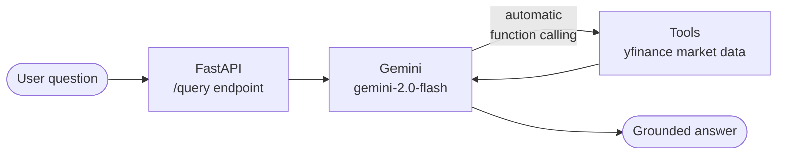

  MSc Artificial Intelligence @ Heriot-Watt University &nbsp;|&nbsp; Dubai, UAE

  
  
  

---

## About

I like making AI do things, not just talk about them.

I'm an AI engineer in the making, interested in what happens when LLMs meet real-world problems, messy data, and actual software systems.

I spend most of my time building things with Python, experimenting with AI architectures, and figuring out how to turn interesting ideas into working systems.

**Currently exploring:** agentic systems, LLM infrastructure, and better ways to make AI applications reliable beyond the prototype.

I also enjoy writing about what I learn and explaining complicated technical ideas in ways that actually make sense.

---

## Tech Stack

 

---

## Featured Projects

### How FinSight works

An AI financial assistant: a FastAPI backend where Gemini decides which market-data tool to call.

---

